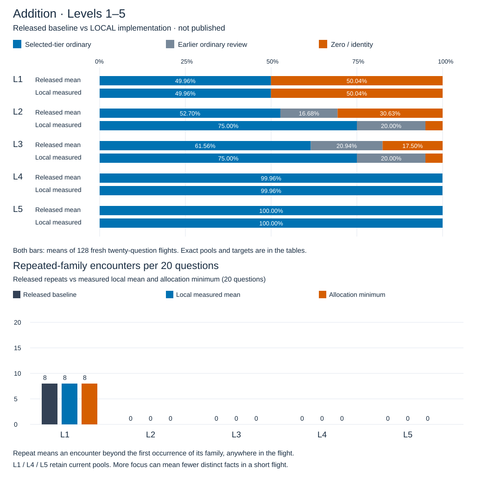
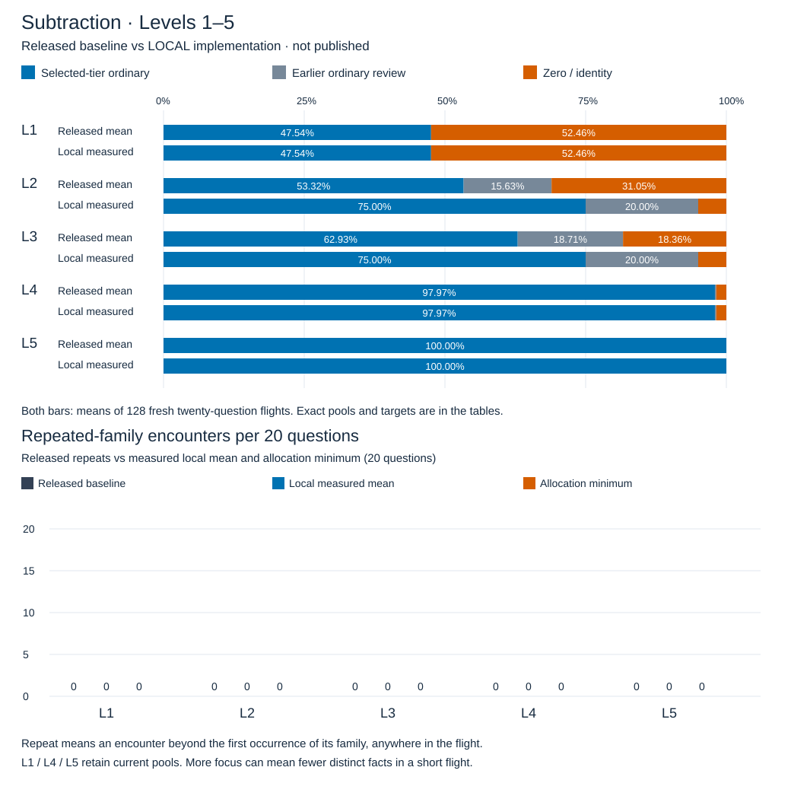
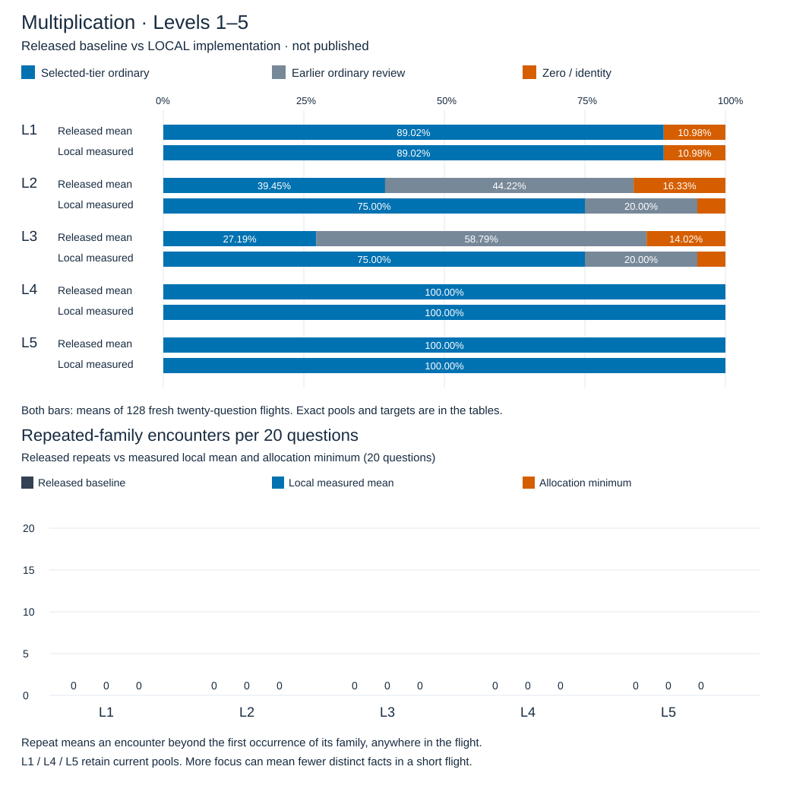
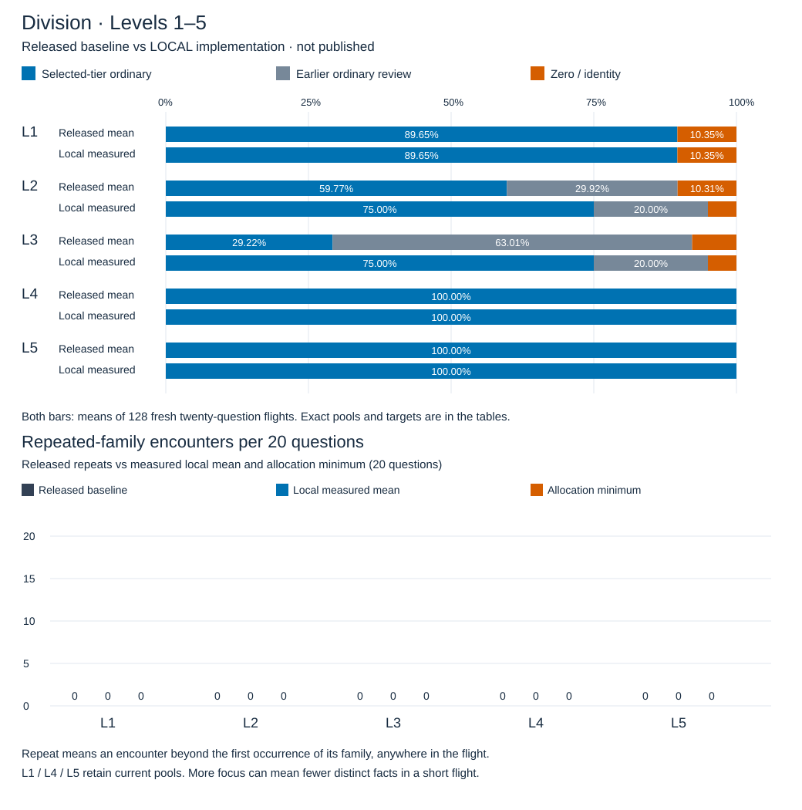
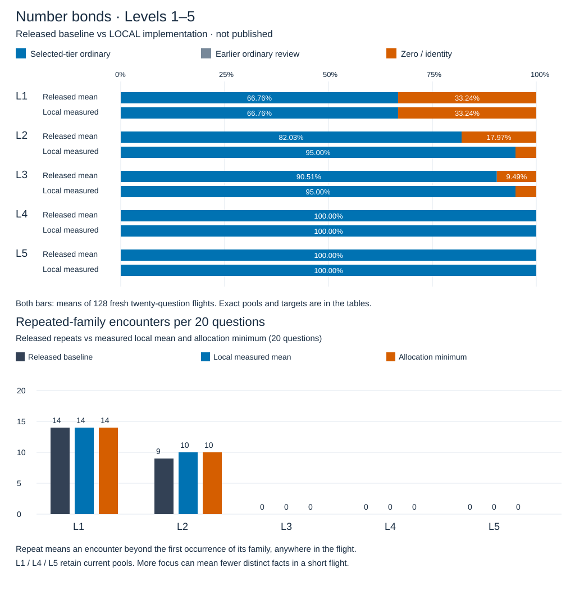
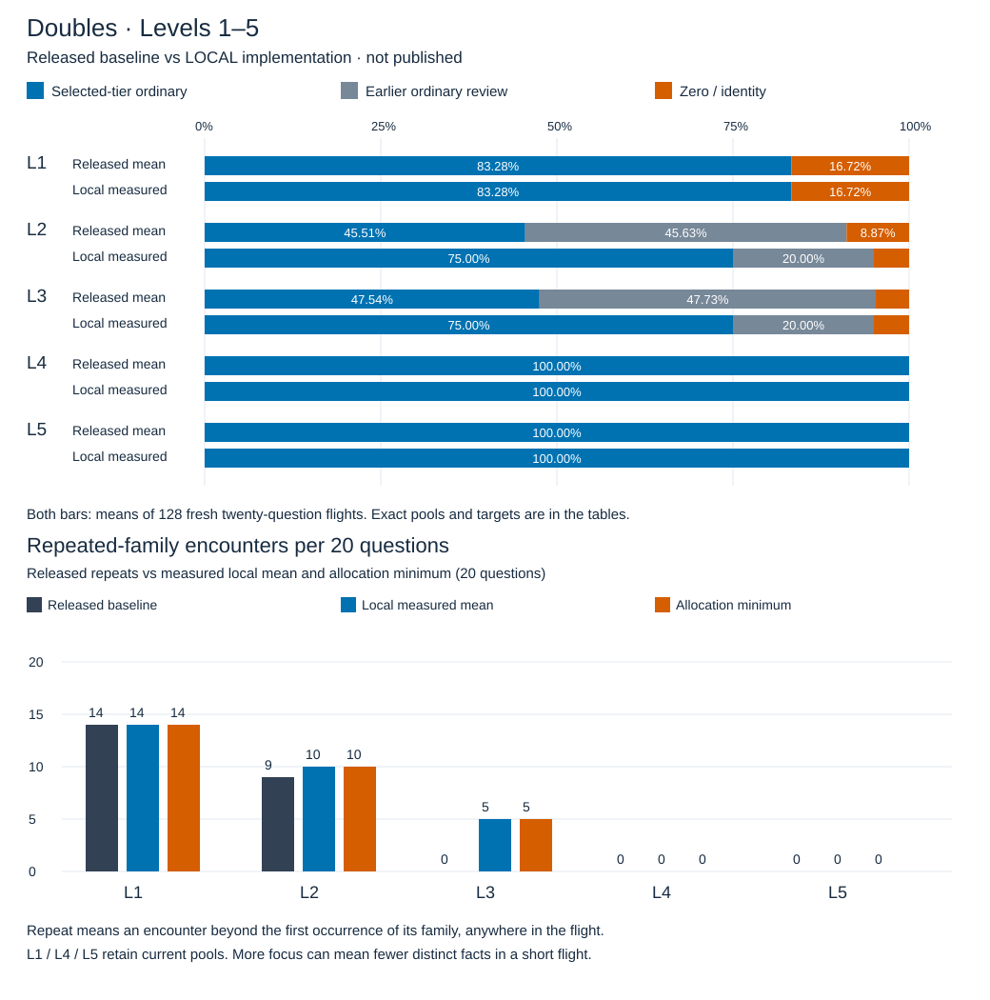
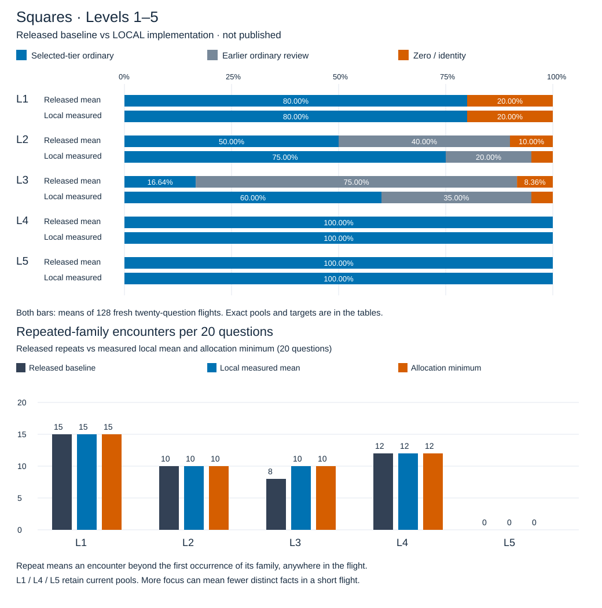

# What Children Practice in Fact Flight

**An educator and parent guide · local review draft · not published**

Fact Flight offers freely chosen arithmetic practice. A numbered level describes an allowed question pool, not a child's age, school grade, measured ability or a prescribed learning path. Different activities introduce different ranges, and some levels intentionally include facts available in earlier levels.

This guide answers three questions: **What can appear? How often does the current generator select it? What changes are being considered?** It describes mathematical content and recorded performance, not evidence of educational effectiveness.

## 1. Released behavior and local changes are different

<!-- BEGIN GENERATED STATUS -->
**Source check:** the local generator does not match the local `v6.2.0` release tag. This is a source comparison, not verification of a live deployment. Allocation: `numbered-mix-proposal-v1`, dated 2026-11-18; **owner-approved allocation; implemented locally, not published**. Released baseline data is retained separately; local generator version is numbered-mix-v1.
<!-- END GENERATED STATUS -->

- **Released baseline** means the v6.2.0 generator. Its exact pools and synthetic audit are preserved separately.
- **Local implementation** means the owner-authorized numbered-mix-v1 generator, now connected to ordinary L2/L3 practice on the development branch. It is not released or published.
- **Allocation target** means the approved twenty-question distribution. Measured local bars show what the generator actually produced; targets and arithmetic minima remain labelled separately.
- **Local calculation foundation** includes reporting and readiness functions that remain disconnected from the released Progress page and menus. Shared content definitions now also support generation.

The original multiplication School Test is preserved. The new local mix applies to ordinary numbered-level practice, not School Test or an explicitly chosen table such as table 1.

## 2. What the terms mean

| Term | Plain-language meaning | Example or caution |
|---|---|---|
| Selected level | The level chosen for the flight and its allowed pool | Selecting L3 does not mean every question first appears at L3. |
| Selected-tier ordinary fact | A non-identity family first introduced in that numbered pool | 11² belongs to the new part of Squares L3. |
| Earlier-level review | A non-identity family already eligible at an earlier numbered level | 5² is earlier review when encountered in Squares L3. |
| Ordinary / non-identity | Not flagged by one of the narrow patterns below | It does **not** mean difficult. 2×5 remains ordinary. |
| Zero / identity pattern | A defined zero, unit or equal-operand shortcut pattern | These can be important introductory practice, not automatically wasted time. |
| Fact family | The canonical question counted for coverage and balanced generation | 4×7 and 7×4 share a family; both presentations remain possible. |
| Encounter | A generated question with at least one answer submission or skip | An untouched worksheet question is not an encounter. |
| Coverage | How many different eligible families have been encountered | Ten repetitions of one family do not establish ten-family coverage. |
| Exact repeat | The same displayed question appears again | 7×8 followed later by 7×8. |
| Family repeat | The same canonical family appears again, possibly reversed | 7×8 and 8×7 are two encounters of one family. |
| Structural similarity | Different families share an answer or recognizable structure | 4−4 then 5−5; or 8−3 then 9−4, both answering 5. |

**The graph categories never overlap.** Zero/identity questions are separated first. Remaining questions are classified as selected-tier ordinary or earlier-level ordinary review. An identity is not counted a second time as review. Earlier-tier membership is a mathematical classification, not a validated measure of cognitive difficulty.

Addition and multiplication reversals share a family. Subtraction and division retain operand order. Bonds retain their total and known/missing-part relationship: `3 + ? = 10` and `? + 3 = 10` share a family, but `7 + ? = 10` is a different missing-part question. Equivalent arithmetic in two different activities does not merge their histories or readiness evidence.

## 3. Fact types across all eight activities

| Activity | Ordinary examples | Zero / identity patterns | What is not implied |
|---|---|---|---|
| Addition | 2+3; 8+7; 24+36 | Zero addend: n+0 or 0+n, including 0+0 | 1+n and doubles such as 4+4 remain ordinary. |
| Subtraction | 8−3; 15−7; 64−28 | Subtract zero (n−0); equal operands (n−n) | Equal operands give zero. 0−0 has both flags but counts once. |
| Multiplication | 2×5; 7×8; 16×7 | Unit factor (n×1 or 1×n) | Zero factors have a defined flag but are absent from current pools. ×2/×5/×10 are not blanket identities. |
| Division | 12÷3; 56÷7; 96÷6 | Equal operands (n÷n=1) in current pools | Unit divisors and zero dividends are defined flags but absent from current numbered pools. Division by zero is invalid. |
| Number bonds | 3+?=10; ?+7=20 | Known zero or missing zero, with either unknown position | The total defines the scope; bonds are not interchangeable with ordinary addition prompts. |
| Doubles | Double 1; Double 7; Double 24 | Double 0 | Double 1 remains ordinary in this narrow classification. |
| Halves | Half of 2; Half of 14; Half of 48 | Half of 0 | Inputs are even whole numbers, not fractional-answer exercises. |
| Squares | 2²; 11²; 16² | 1² | A zero-base flag exists, but current square pools start at 1. |

“Freebie” is an informal description, not a reliable educational category. This guide uses specific mathematical flags instead. Familiarity depends on the learner and context.

Carrying/borrowing, round-ten operands, small answers, shared operands and neighboring operands are separate, overlapping structural descriptors. A small answer does not establish that a question required little thought. Chosen tables intentionally repeat an operand; helpful comparison exercises may intentionally use neighboring facts.

## 4. Current activity and level ranges

<!-- BEGIN GENERATED RANGES -->
| Activity | Level | Current range label | Families | Ordinary families by earliest L1 / L2 / L3 / L4 / L5 | Zero/identity families |
|---|---|---|---:|---|---:|
| Addition | L1 | Sums within 5 | 12 | 6 / 0 / 0 / 0 / 0 | 6 |
| Addition | L2 | Sums within 10 | 36 | 6 / 19 / 0 / 0 / 0 | 11 |
| Addition | L3 | Sums within 20 | 121 | 6 / 19 / 75 / 0 / 0 | 21 |
| Addition | L4 | Two digits + two digits (10–99) | 4,095 | 0 / 0 / 1 / 4094 / 0 | 0 |
| Addition | L5 | Three digits + two digits | 81,000 | 0 / 0 / 0 / 0 / 81000 | 0 |
| Subtraction | L1 | Subtract within 5 | 21 | 10 / 0 / 0 / 0 / 0 | 11 |
| Subtraction | L2 | Subtract within 10 | 66 | 10 / 35 / 0 / 0 / 0 | 21 |
| Subtraction | L3 | Subtract within 20 | 231 | 10 / 35 / 145 / 0 / 0 | 41 |
| Subtraction | L4 | Two digits − two digits | 4,040 | 0 / 0 / 10 / 3950 / 0 | 80 |
| Subtraction | L5 | Three digits − two digits | 81,000 | 0 / 0 / 0 / 0 / 81000 | 0 |
| Multiplication | L1 | 2, 5 & 10 tables | 27 | 24 / 0 / 0 / 0 / 0 | 3 |
| Multiplication | L2 | 2–10 tables | 54 | 24 / 21 / 0 / 0 / 0 | 9 |
| Multiplication | L3 | 2–12 tables | 77 | 24 / 21 / 21 / 0 / 0 | 11 |
| Multiplication | L4 | 13–20 × 2–12 | 88 | 0 / 0 / 0 / 88 / 0 | 0 |
| Multiplication | L5 | 21–99 × 2–12 | 869 | 0 / 0 / 0 / 0 / 869 | 0 |
| Division | L1 | 2, 5 & 10 families | 30 | 27 / 0 / 0 / 0 / 0 | 3 |
| Division | L2 | Divide by 2–10 | 90 | 27 / 54 / 0 / 0 / 0 | 9 |
| Division | L3 | Divide by 2–12 | 132 | 27 / 54 / 40 / 0 / 0 | 11 |
| Division | L4 | Exact division · quotients 13–20 | 88 | 0 / 0 / 0 / 88 / 0 | 0 |
| Division | L5 | Exact division · quotients 21–99 | 869 | 0 / 0 / 0 / 0 / 869 | 0 |
| Number bonds | L1 | Make 5 | 6 | 4 / 0 / 0 / 0 / 0 | 2 |
| Number bonds | L2 | Make 10 | 11 | 0 / 9 / 0 / 0 / 0 | 2 |
| Number bonds | L3 | Make 20 | 21 | 0 / 0 / 19 / 0 / 0 | 2 |
| Number bonds | L4 | Make 100 · parts 10–90 | 81 | 0 / 0 / 0 / 81 / 0 | 0 |
| Number bonds | L5 | Make 1,000 · parts 100–900 | 801 | 0 / 0 / 0 / 0 / 801 | 0 |
| Doubles | L1 | Double 0–5 | 6 | 5 / 0 / 0 / 0 / 0 | 1 |
| Doubles | L2 | Double 0–10 | 11 | 5 / 5 / 0 / 0 / 0 | 1 |
| Doubles | L3 | Double 0–20 | 21 | 5 / 5 / 10 / 0 / 0 | 1 |
| Doubles | L4 | Double 21–99 | 79 | 0 / 0 / 0 / 79 / 0 | 0 |
| Doubles | L5 | Double 100–999 | 900 | 0 / 0 / 0 / 0 / 900 | 0 |
| Halves | L1 | Even numbers to 10 | 6 | 5 / 0 / 0 / 0 / 0 | 1 |
| Halves | L2 | Even numbers to 20 | 11 | 5 / 5 / 0 / 0 / 0 | 1 |
| Halves | L3 | Even numbers to 40 | 21 | 5 / 5 / 10 / 0 / 0 | 1 |
| Halves | L4 | Even numbers 42–198 | 79 | 0 / 0 / 0 / 79 / 0 | 0 |
| Halves | L5 | Even numbers 200–1,998 | 900 | 0 / 0 / 0 / 0 / 900 | 0 |
| Squares | L1 | Bases 1–5 | 5 | 4 / 0 / 0 / 0 / 0 | 1 |
| Squares | L2 | Bases 1–10 | 10 | 4 / 5 / 0 / 0 / 0 | 1 |
| Squares | L3 | Bases 1–12 | 12 | 4 / 5 / 2 / 0 / 0 | 1 |
| Squares | L4 | Bases 13–20 | 8 | 0 / 0 / 0 / 8 / 0 | 0 |
| Squares | L5 | Bases 21–50 | 30 | 0 / 0 / 0 / 0 / 30 | 0 |
<!-- END GENERATED RANGES -->

Quick, Free, Timed and Custom Test are session formats over activity content, not additional arithmetic types. Released v6.2 Choose Tables offers multiplication 1–10 with the other factor 1–10. The local v6.3 extension offers multiplication tables and division divisors 1–12, each with an explicit range through 10 or 12. School Test retains its original tables 2–10, 60 questions and two-minute timed preset. Missed-fact review uses source-scoped questions with fresh answer state. These new selectors are implemented locally, not published. Existing selected-table records retain their original through-10 meaning. New scopes and their backups require v6.3; see the [compatibility record](v6.3-families-verification.md).

## 5. Reading the before-and-after graphs

Each activity figure includes **all five levels**. Both released and local bars show measured means from the same 128 seeds for twenty-question flights. The tables retain exact released pool composition and approved local targets. Individual five-question flights vary; the generated data also records their minimum, median, maximum and mean selected-tier and identity counts.

Most L2 cycles contain 15 selected-tier ordinary questions, four L1 ordinary review questions and one identity where eligible. Most L3 cycles contain 15 selected-tier ordinary, three L2 review, one L1 review and one eligible identity. Squares L3 uses 12 selected, five L2 review, two L1 review and one identity. Bonds L2/L3 use 19 selected ordinary and one identity. Missing identity or review capacity goes to selected-tier ordinary facts; no pool is broadened. The identity allowance is never filled by importing an ineligible fact.

Level 1 and Levels 4–5 retain their released generators and pools. Introductory identity coverage remains available, and no review is injected into advanced pools. Chosen families use balanced family rounds without numbered-level allocation quotas; this preserves intentional table-1/divisor-1 practice. Missed-fact review keeps each fact’s source scope. School Test remains unchanged.

**Carryover is temporary and learner-specific.** Each learner and activity/level has its own unfinished twenty-question cycle and bucket rounds in memory. Four five-question flights therefore accumulate one cycle. Reload starts fresh; Guest state clears on learner change. Switching levels does not mix their allocations. The allocation counts **generated questions**, including questions left untouched when a finite flight is stopped. Undo, correction and revisiting an existing question do not generate another fact or consume another allocation slot. No allocator state or policy field is saved in historical records.

The lower graph compares repeated-family encounters in twenty questions: released balanced rounds, the measured local mean, and the arithmetic minimum imposed by the target. The minimum does not guarantee that every flight attains it. More selected-tier concentration can increase repetition when that tier is small. Repetition anywhere in a flight differs from an immediate duplicate.

<!-- BEGIN GENERATED ACTIVITY FIGURES -->
### Addition



| Level | Released pool selected / earlier / identity | Approved target selected / earlier / identity | Ordinary review split | Repeats in 20: released → local mean (minimum) |
|---|---|---|---|---|
| L1 | 50.00% / 0.00% / 50.00% | Unchanged: 50.00% / 0.00% / 50.00% | Existing pool | 8 → 8.00 (8–8) |
| L2 | 52.78% / 16.67% / 30.56% | 75.00% / 20.00% / 5.00% | L1: 4/20 | 0 → 0.00 (0–0) |
| L3 | 61.98% / 20.66% / 17.36% | 75.00% / 20.00% / 5.00% | L1: 1/20; L2: 3/20 | 0 → 0.00 (0–0) |
| L4 | 99.98% / 0.02% / 0.00% | Unchanged: 99.98% / 0.02% / 0.00% | Existing pool | 0 → 0.00 (0–0) |
| L5 | 100.00% / 0.00% / 0.00% | Unchanged: 100.00% / 0.00% / 0.00% | Existing pool | 0 → 0.00 (0–0) |

Target percentages show the identity ceiling filled; missing identity capacity moves to selected-tier ordinary facts. Minimum endpoints correspond to using and not using that slot. The local implementation uses one identity per cycle where eligible; five-question flights share the cycle in memory.

Even ordinary advanced facts differ structurally. L4: 1000/4095 (24.42%) require no carrying; L5: 22275/81000 (27.50%) require no carrying. These overlapping descriptors are not mastery or difficulty ratings.

### Subtraction



| Level | Released pool selected / earlier / identity | Approved target selected / earlier / identity | Ordinary review split | Repeats in 20: released → local mean (minimum) |
|---|---|---|---|---|
| L1 | 47.62% / 0.00% / 52.38% | Unchanged: 47.62% / 0.00% / 52.38% | Existing pool | 0 → 0.00 (0–0) |
| L2 | 53.03% / 15.15% / 31.82% | 75.00% / 20.00% / 5.00% | L1: 4/20 | 0 → 0.00 (0–0) |
| L3 | 62.77% / 19.48% / 17.75% | 75.00% / 20.00% / 5.00% | L1: 1/20; L2: 3/20 | 0 → 0.00 (0–0) |
| L4 | 97.77% / 0.25% / 1.98% | Unchanged: 97.77% / 0.25% / 1.98% | Existing pool | 0 → 0.00 (0–0) |
| L5 | 100.00% / 0.00% / 0.00% | Unchanged: 100.00% / 0.00% / 0.00% | Existing pool | 0 → 0.00 (0–0) |

Target percentages show the identity ceiling filled; missing identity capacity moves to selected-tier ordinary facts. Minimum endpoints correspond to using and not using that slot. The local implementation uses one identity per cycle where eligible; five-question flights share the cycle in memory.

Even ordinary advanced facts differ structurally. L4: 2420/4040 (59.90%) require no borrowing; L5: 22275/81000 (27.50%) require no borrowing. These overlapping descriptors are not mastery or difficulty ratings.

### Multiplication



| Level | Released pool selected / earlier / identity | Approved target selected / earlier / identity | Ordinary review split | Repeats in 20: released → local mean (minimum) |
|---|---|---|---|---|
| L1 | 88.89% / 0.00% / 11.11% | Unchanged: 88.89% / 0.00% / 11.11% | Existing pool | 0 → 0.00 (0–0) |
| L2 | 38.89% / 44.44% / 16.67% | 75.00% / 20.00% / 5.00% | L1: 4/20 | 0 → 0.00 (0–0) |
| L3 | 27.27% / 58.44% / 14.29% | 75.00% / 20.00% / 5.00% | L1: 1/20; L2: 3/20 | 0 → 0.00 (0–0) |
| L4 | 100.00% / 0.00% / 0.00% | Unchanged: 100.00% / 0.00% / 0.00% | Existing pool | 0 → 0.00 (0–0) |
| L5 | 100.00% / 0.00% / 0.00% | Unchanged: 100.00% / 0.00% / 0.00% | Existing pool | 0 → 0.00 (0–0) |

Target percentages show the identity ceiling filled; missing identity capacity moves to selected-tier ordinary facts. Minimum endpoints correspond to using and not using that slot. The local implementation uses one identity per cycle where eligible; five-question flights share the cycle in memory.

### Division



| Level | Released pool selected / earlier / identity | Approved target selected / earlier / identity | Ordinary review split | Repeats in 20: released → local mean (minimum) |
|---|---|---|---|---|
| L1 | 90.00% / 0.00% / 10.00% | Unchanged: 90.00% / 0.00% / 10.00% | Existing pool | 0 → 0.00 (0–0) |
| L2 | 60.00% / 30.00% / 10.00% | 75.00% / 20.00% / 5.00% | L1: 4/20 | 0 → 0.00 (0–0) |
| L3 | 30.30% / 61.36% / 8.33% | 75.00% / 20.00% / 5.00% | L1: 1/20; L2: 3/20 | 0 → 0.00 (0–0) |
| L4 | 100.00% / 0.00% / 0.00% | Unchanged: 100.00% / 0.00% / 0.00% | Existing pool | 0 → 0.00 (0–0) |
| L5 | 100.00% / 0.00% / 0.00% | Unchanged: 100.00% / 0.00% / 0.00% | Existing pool | 0 → 0.00 (0–0) |

Target percentages show the identity ceiling filled; missing identity capacity moves to selected-tier ordinary facts. Minimum endpoints correspond to using and not using that slot. The local implementation uses one identity per cycle where eligible; five-question flights share the cycle in memory.

### Number bonds



| Level | Released pool selected / earlier / identity | Approved target selected / earlier / identity | Ordinary review split | Repeats in 20: released → local mean (minimum) |
|---|---|---|---|---|
| L1 | 66.67% / 0.00% / 33.33% | Unchanged: 66.67% / 0.00% / 33.33% | Existing pool | 14 → 14.00 (14–14) |
| L2 | 81.82% / 0.00% / 18.18% | 95.00% / 0.00% / 5.00% | None | 9 → 10.00 (10–11) |
| L3 | 90.48% / 0.00% / 9.52% | 95.00% / 0.00% / 5.00% | None | 0 → 0.00 (0–1) |
| L4 | 100.00% / 0.00% / 0.00% | Unchanged: 100.00% / 0.00% / 0.00% | Existing pool | 0 → 0.00 (0–0) |
| L5 | 100.00% / 0.00% / 0.00% | Unchanged: 100.00% / 0.00% / 0.00% | Existing pool | 0 → 0.00 (0–0) |

Target percentages show the identity ceiling filled; missing identity capacity moves to selected-tier ordinary facts. Minimum endpoints correspond to using and not using that slot. The local implementation uses one identity per cycle where eligible; five-question flights share the cycle in memory.

### Doubles



| Level | Released pool selected / earlier / identity | Approved target selected / earlier / identity | Ordinary review split | Repeats in 20: released → local mean (minimum) |
|---|---|---|---|---|
| L1 | 83.33% / 0.00% / 16.67% | Unchanged: 83.33% / 0.00% / 16.67% | Existing pool | 14 → 14.00 (14–14) |
| L2 | 45.45% / 45.45% / 9.09% | 75.00% / 20.00% / 5.00% | L1: 4/20 | 9 → 10.00 (10–11) |
| L3 | 47.62% / 47.62% / 4.76% | 75.00% / 20.00% / 5.00% | L1: 1/20; L2: 3/20 | 0 → 5.00 (5–6) |
| L4 | 100.00% / 0.00% / 0.00% | Unchanged: 100.00% / 0.00% / 0.00% | Existing pool | 0 → 0.00 (0–0) |
| L5 | 100.00% / 0.00% / 0.00% | Unchanged: 100.00% / 0.00% / 0.00% | Existing pool | 0 → 0.00 (0–0) |

Target percentages show the identity ceiling filled; missing identity capacity moves to selected-tier ordinary facts. Minimum endpoints correspond to using and not using that slot. The local implementation uses one identity per cycle where eligible; five-question flights share the cycle in memory.

### Halves


| Level | Released pool selected / earlier / identity | Approved target selected / earlier / identity | Ordinary review split | Repeats in 20: released → local mean (minimum) |
|---|---|---|---|---|
| L1 | 83.33% / 0.00% / 16.67% | Unchanged: 83.33% / 0.00% / 16.67% | Existing pool | 14 → 14.00 (14–14) |
| L2 | 45.45% / 45.45% / 9.09% | 75.00% / 20.00% / 5.00% | L1: 4/20 | 9 → 10.00 (10–11) |
| L3 | 47.62% / 47.62% / 4.76% | 75.00% / 20.00% / 5.00% | L1: 1/20; L2: 3/20 | 0 → 5.00 (5–6) |
| L4 | 100.00% / 0.00% / 0.00% | Unchanged: 100.00% / 0.00% / 0.00% | Existing pool | 0 → 0.00 (0–0) |
| L5 | 100.00% / 0.00% / 0.00% | Unchanged: 100.00% / 0.00% / 0.00% | Existing pool | 0 → 0.00 (0–0) |

Target percentages show the identity ceiling filled; missing identity capacity moves to selected-tier ordinary facts. Minimum endpoints correspond to using and not using that slot. The local implementation uses one identity per cycle where eligible; five-question flights share the cycle in memory.

### Squares



| Level | Released pool selected / earlier / identity | Approved target selected / earlier / identity | Ordinary review split | Repeats in 20: released → local mean (minimum) |
|---|---|---|---|---|
| L1 | 80.00% / 0.00% / 20.00% | Unchanged: 80.00% / 0.00% / 20.00% | Existing pool | 15 → 15.00 (15–15) |
| L2 | 50.00% / 40.00% / 10.00% | 75.00% / 20.00% / 5.00% | L1: 4/20 | 10 → 10.00 (10–11) |
| L3 | 16.67% / 75.00% / 8.33% | 60.00% / 35.00% / 5.00% | L1: 2/20; L2: 5/20 | 8 → 10.00 (10–11) |
| L4 | 100.00% / 0.00% / 0.00% | Unchanged: 100.00% / 0.00% / 0.00% | Existing pool | 12 → 12.00 (12–12) |
| L5 | 100.00% / 0.00% / 0.00% | Unchanged: 100.00% / 0.00% / 0.00% | Existing pool | 0 → 0.00 (0–0) |

Target percentages show the identity ceiling filled; missing identity capacity moves to selected-tier ordinary facts. Minimum endpoints correspond to using and not using that slot. The local implementation uses one identity per cycle where eligible; five-question flights share the cycle in memory.
<!-- END GENERATED ACTIVITY FIGURES -->

## 6. Repetition and sequence quality

The local L2/L3 generator balances families within each allocation bucket. It prefers avoiding immediate family repeats, then recent-three-family repeats, then a third identical answer. Allocation and content validity take precedence over spacing when a small tier cannot satisfy everything. L1/L4/L5 retain the original balanced-round behavior.

<!-- BEGIN GENERATED SEQUENCE FINDINGS -->
The released baseline and local implementation each use 128 seeds per scope at 5 and 20 questions, plus 128 chains of four five-question flights. Local chains carry allocation state across flights. Counts below compare the same test design, not learner performance. Immediate repeats in unchanged scopes remain a known limitation; tighter selected-tier allocation can require relaxing the three-family gap.

| Activity | Level | Identity run: before → local | Same-answer run: before → local | Recent-three-family repeat encounters: before → local (total / 2,560) | Exact boundary duplicates: before → local (/384) |
|---|---|---:|---:|---:|---:|
| Addition | L1 | 8 → 8 | 3 → 3 | 0 → 0 | 0 → 0 |
| Addition | L2 | 5 → 1 | 4 → 2 | 0 → 0 | 0 → 0 |
| Addition | L3 | 4 → 1 | 3 → 2 | 0 → 0 | 0 → 0 |
| Addition | L4 | 0 → 0 | 2 → 2 | 0 → 0 | 0 → 0 |
| Addition | L5 | 0 → 0 | 2 → 2 | 0 → 0 | 0 → 0 |
| Subtraction | L1 | 7 → 7 | 5 → 5 | 0 → 0 | 0 → 0 |
| Subtraction | L2 | 5 → 1 | 4 → 2 | 0 → 0 | 0 → 0 |
| Subtraction | L3 | 4 → 1 | 4 → 2 | 0 → 0 | 0 → 0 |
| Subtraction | L4 | 2 → 2 | 3 → 3 | 0 → 0 | 0 → 0 |
| Subtraction | L5 | 0 → 0 | 2 → 2 | 0 → 0 | 0 → 0 |
| Multiplication | L1 | 2 → 2 | 2 → 2 | 0 → 0 | 0 → 0 |
| Multiplication | L2 | 3 → 1 | 2 → 2 | 0 → 0 | 0 → 0 |
| Multiplication | L3 | 4 → 1 | 2 → 2 | 0 → 0 | 0 → 0 |
| Multiplication | L4 | 0 → 0 | 2 → 2 | 0 → 0 | 0 → 0 |
| Multiplication | L5 | 0 → 0 | 2 → 2 | 0 → 0 | 0 → 0 |
| Division | L1 | 2 → 2 | 3 → 3 | 0 → 0 | 0 → 0 |
| Division | L2 | 3 → 1 | 4 → 2 | 0 → 0 | 0 → 0 |
| Division | L3 | 3 → 1 | 4 → 2 | 0 → 0 | 0 → 0 |
| Division | L4 | 0 → 0 | 4 → 4 | 0 → 0 | 0 → 0 |
| Division | L5 | 0 → 0 | 2 → 2 | 0 → 0 | 0 → 0 |
| Number bonds | L1 | 2 → 2 | 1 → 1 | 0 → 0 | 0 → 0 |
| Number bonds | L2 | 2 → 1 | 1 → 1 | 0 → 0 | 0 → 0 |
| Number bonds | L3 | 2 → 1 | 1 → 1 | 0 → 0 | 0 → 0 |
| Number bonds | L4 | 0 → 0 | 1 → 1 | 0 → 0 | 0 → 0 |
| Number bonds | L5 | 0 → 0 | 1 → 1 | 0 → 0 | 0 → 0 |
| Doubles | L1 | 1 → 1 | 1 → 1 | 0 → 0 | 0 → 0 |
| Doubles | L2 | 1 → 1 | 1 → 1 | 0 → 0 | 0 → 0 |
| Doubles | L3 | 1 → 1 | 1 → 1 | 0 → 0 | 0 → 0 |
| Doubles | L4 | 0 → 0 | 1 → 1 | 0 → 0 | 0 → 0 |
| Doubles | L5 | 0 → 0 | 1 → 1 | 0 → 0 | 0 → 0 |
| Halves | L1 | 1 → 1 | 1 → 1 | 0 → 0 | 0 → 0 |
| Halves | L2 | 1 → 1 | 1 → 1 | 0 → 0 | 0 → 0 |
| Halves | L3 | 1 → 1 | 1 → 1 | 0 → 0 | 0 → 0 |
| Halves | L4 | 0 → 0 | 1 → 1 | 0 → 0 | 0 → 0 |
| Halves | L5 | 0 → 0 | 1 → 1 | 0 → 0 | 0 → 0 |
| Squares | L1 | 1 → 1 | 1 → 1 | 0 → 0 | 109 → 109 |
| Squares | L2 | 1 → 1 | 1 → 1 | 0 → 0 | 0 → 0 |
| Squares | L3 | 1 → 1 | 1 → 1 | 0 → 851 | 0 → 0 |
| Squares | L4 | 0 → 0 | 1 → 1 | 0 → 0 | 0 → 0 |
| Squares | L5 | 0 → 0 | 1 → 1 | 0 → 0 | 0 → 0 |

All identity, exact/family repeat, shared-operand and neighboring-pattern counters remain available in the [generated dataset](data/educator-practice-data.json). Similarity measures overlap and must not be added.
<!-- END GENERATED SEQUENCE FINDINGS -->

A randomized rotation of a smoothly distributed twenty-slot cycle avoids a fixed opening pattern. Each eligible cycle contains only one identity, so two consecutive identities may occur at a cycle boundary but longer runs do not occur in changed scopes. Family bags and recent questions carry across short flights. The selected bucket always stays valid; diversity preferences are relaxed without an unbounded retry loop.

These sequence changes do not establish improved learning, recall or retention. Unchanged L1 pools can still have longer identity runs and immediate repeats across separate flights. Physical-device voice and touch acceptance remains pending.

## 7. Interpreting results and readiness

Current records distinguish first-try success, final correctness, incorrect submissions, skips, generated questions and elapsed time. A correction is useful practice, but it is not a first-try success. Ten untouched questions must not be described as ten attempted mistakes.

The new local reporting calculations explicitly separate **first-try accuracy over encountered questions** from **score over generated questions**. For example, nine first-try successes out of ten encounters among twenty generated questions gives 90% encounter accuracy and a 45% generated-question score. This is a denominator distinction, not improved performance. The current result-screen percentage labelled first-try accuracy uses generated questions; the new labels are not yet wired into the app.

The local readiness rule uses aggregate accuracy of at least 95%, minimum encounters, completed-flight evidence and distinct content coverage. Six five-question flights can contribute thirty encounters; one corrected error leaves 29/30 first-try successes, or 96.7%. Completion credits use the outer recent-flight window so long flights remain a viable route; accuracy and coverage use capped recent encounters. School Test achievement is a separate timed measure.

These are product rules under local development, not a standardized assessment or proof of durable mastery. They have no later-day retention requirement. A future trophy must explain its evidence and limitations; it must not imply that a child has permanently mastered an activity. The released app has no new readiness-based practice lock from this work. See the [versioned rules](v6.3-rules-specification.md) for precise windows, coverage and exceptions.

Recorded active time includes input, retries and interaction delays; it is not pure thinking or recall speed. Incorrect numeric answers can reflect arithmetic, typing, speech substitutions or interruption. Reports cannot reliably distinguish those causes. Browser speech processing may use an online service; the app stores recognized transcripts locally with results, but not microphone recordings. This guide and its generated datasets include no learner histories or speech transcripts.

## 8. Evidence, limitations and regeneration

<!-- BEGIN GENERATED METHOD -->
The audit contains **40 scopes, 30,720 synthetic flights and 230,400 generated questions**. It uses 128 deterministic seeds dispersed across the random-number state space, not learner histories. Both mix bars show sampled means; exact family counts remain in the tables. Local bars use newly generated samples. Allocation targets are recorded in the [documentation-only allocation input](data/question-mix-proposal.json).

The [complete generated dataset](data/educator-practice-data.json) records exact counts, simulated distributions, sequence diagnostics and source hashes. SHA-256 fingerprints normalize line endings; no machine paths or timestamps are captured.

| Source | SHA-256 |
|---|---|
| `scripts/math-activities.js` | `a9c48bed20c1e02acdce554b3eb80bd61c7ab1f2acf69f9008dacb8aa2b6b48c` |
| `scripts/content-definitions.js` | `0a2e1444a53d44e7b03284f0b1e81321b5d060d50fa5b712ac524fc438b50184` |
| `scripts/practice-generator.js` | `f0e8666ba69d922caaf9850eb37c9f8988c64c5a429e8d816cd4028a1e037f9d` |
| `tests/question-mix-audit.cjs` | `12d474524e3212ce72024be755f64b0ae215ee86dfe8e0eaeb5b79f4b49e71ba` |
| `docs/data/question-mix-proposal.json` | `3df9c1981fe3d87b6d7c07d652b2ba51f80ff152abe27f15c89be73b92be2bc0` |
| `docs/data/question-mix-baseline.json` | `482fa516614112f9d74e1aad5e08e3c83ae61da91f070a6c3c34bf1f7d94d900` |
<!-- END GENERATED METHOD -->

All quantitative content in this guide comes from definitions or invented generator sequences. No individual learner export, private screenshot, real nickname or personal diagnostic is included. The audit does not establish age suitability, treatment effectiveness, learning gains or educator endorsement.

To regenerate locally:

```sh
node scripts/build-educator-guide.cjs
node scripts/build-educator-guide.cjs --check
```

The builder reads the current shared definitions and reruns the synthetic audit, regenerates the graphs, exact data and marked quantitative sections, and preserves the surrounding explanatory prose. The approved target JSON remains a documentation-only input. The runtime allocation is defined in the shared content module; generator tests and documentation checks verify their agreement. Updating documentation alone does not change runtime behavior. After a real generator change, revise the audit and explanatory claims as necessary before treating the guide as current; regeneration alone cannot verify educational claims or new allocation semantics.

Before release, rerun checks, visually inspect figures, review definitions and exceptions, and confirm the source baseline and proposal status. Obtain separate owner approval before committing, pushing or publishing. This draft does not authorize any of those actions.
